# W10 · Inference to Prediction

**Advanced Machine Learning · November 3, 2026**

W4–W7 conceptual rebuild and transfer to the original midterm Q3–Q5. These notes use small teaching cases from W5/W7. The separate workbook preserves the original questions and provides blank working space. There is no new graded assignment.

## S01 — What Is Observed and What Is Random?

Start with a question, not an algorithm. In the one-slope model, the training data are $D=\{(x_i,y_i)\}_{i=1}^{n}$. After observation, these values are fixed in our conditioning statement. The unknown weight $w$ has a posterior distribution. A prediction input $x_*$ specifies where we ask a new question.

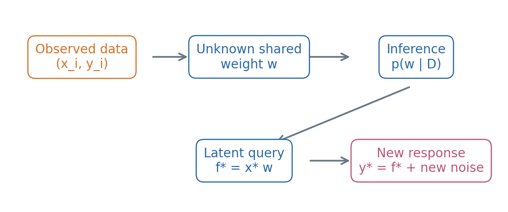

**F01. Reading order:** observed data → unknown weight → posterior → prediction query. Blue objects carry uncertainty about the shared function; a new response also includes independent new noise.

For a scalar slope with no intercept,

$$
f(x)=xw,\qquad y_i=x_iw+\epsilon_i.
$$

The same weight appears in every function value. The subscript on $\epsilon_i$ identifies a separate noise variable for each observation. Do not replace a shared unknown weight by an independently resampled weight at every input.

**Predict first:** if $x_*=0$, which uncertainty remains in a new response?

### S01 continued · A notation and conditioning check

| Symbol | Object in this lesson | What to keep separate |
|---|---|---|
| $D$ | Observed training inputs and responses | A future observation is a different query |
| $w$ | One unknown shared slope | A posterior distribution differs from one estimate |
| $\tau^2$ | Prior weight variance | Prior precision is $1/\tau^2$ |
| $\sigma^2$ | Known observation-noise variance | The noise SD is $\sigma$ |
| $f_*=x_*w$ | Latent function value | It contains no new observation noise |
| $y_*=f_*+\epsilon_*$ | New noisy response | Its noise is independent of training noises and $w$ |
| $M$ | Number of simulated posterior draws | Changing $M$ does not add observed data |

The notation $\mathcal N(m,v)$ uses **variance** as its second argument throughout these notes. Our existing fitting API instead accepts a noise **standard deviation**. Translate the units before calling a function.

A statement such as $p(w\mid D)$ conditions on the observed data. A prior covariance such as $\operatorname{Cov}(f(x),f(x'))$ is evaluated before conditioning on $D$. Write the conditioning explicitly whenever two formulas look similar.

Expectation averages an object over its stated distribution. Variance averages squared deviations from that expectation. Multiplying a random variable by $c$ multiplies its mean by $c$, its variance by $c^2$, and its SD by $|c|$.

The examples are transparent synthetic calculations. They establish arithmetic and modeling distinctions; they are not empirical claims about a real prediction task.

**Explain:** identify the random variable, the conditioning information and the requested output before calculating anything in Q3, Q4 or Q5.

## S02 — From Variational Inference to Prediction

W4 introduced a tractable variational family. W5 used simulation and importance weights. W6 rebuilt inference from observations and unknowns. W7 connected weight uncertainty to function values and predictions.

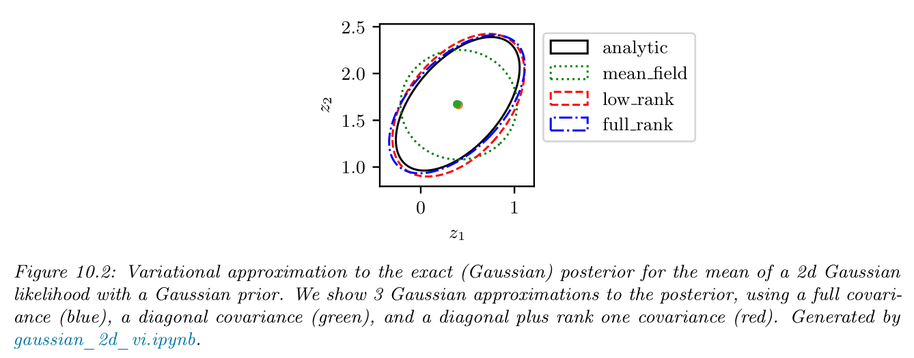

**F02. Source:** Murphy, *Probabilistic Machine Learning: Advanced Topics*, supplied December 10, 2025 edition, Fig. 10.2, printed p. 442. Selected figure and original caption are retained unchanged under the course's authorized figure-use instructions.

Read the legend and the tilted analytic contour. Restricting covariance structure can restrict the approximation even after optimization has converged. This picture illustrates a family limitation; it does not show an error caused merely by too few simulated draws.

The letter $q$ has two roles in this review. In variational inference it denotes an approximating distribution optimized within a family. In importance sampling it denotes the proposal from which draws are obtained. A variational distribution can sometimes be used as a proposal, but the roles and objectives must still be stated.

| Method or object | Main question |
|---|---|
| Variational approximation | Which member of a chosen family approximates the posterior? |
| Importance sampling | How do proposal draws contribute to a target expectation? |
| MCMC / SMC | How are dependent or sequential samples constructed? |
| Predictive distribution | What uncertainty remains in the specified future query? |

We use exact small Gaussian models today so numerical checks remain inspectable. Increasing simulation draws reduces numerical error under suitable conditions; it cannot repair an inappropriate variational family or a misspecified likelihood.

## S03 — Target, Proposal, and Draw Weights

Consider states $z\in\{0,1,2\}$ and the function $g(z)=z$. This is the non-exam discrete teaching case from W5.

| State $z$ | 0 | 1 | 2 |
|---|---:|---:|---:|
| Target $p(z)$ | 0.20 | 0.30 | 0.50 |
| Proposal $q(z)$ | 0.50 | 0.25 | 0.25 |

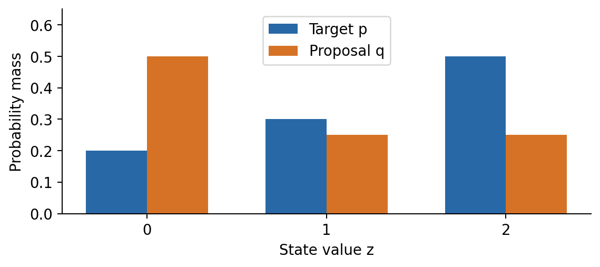

**F03. Read:** the proposal visits state 0 more often than the target mass suggests, and state 2 less often. Both distributions sum to one.

Suppose the given independent proposal draws are $z^{(1:4)}=(0,1,1,2)$. The draws are fixed for the following calculation. A separate repeated-sampling experiment would require actually generating additional draws.

**Equation E03.1. Per-draw weights**

$$
w_i=\frac{p(z^{(i)})}{q(z^{(i)})},
\qquad W_i=\frac{w_i}{\sum_{j=1}^{N}w_j}.
$$

The support requirement is essential: the proposal must assign positive probability wherever the target contribution needs to be sampled. A zero proposal probability cannot be corrected by a finite weight.

**Before proceeding:** which two entries in the draw table have equal weights, and why do both entries remain?

### S03 continued · Calculate one row at a time

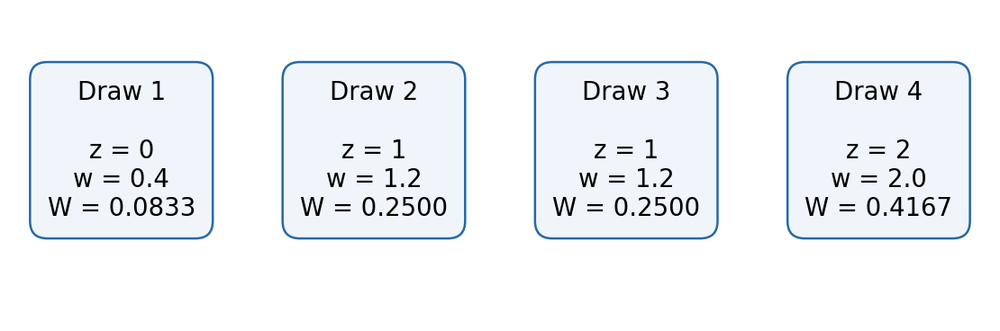

**F04. Read left to right:** draw ID → state → raw ratio → normalized weight. Equal state values do not merge two draws into one.

| Draw ID | State | Target mass | Proposal mass | Raw $w_i$ | Normalized $W_i$ |
|---:|---:|---:|---:|---:|---:|
| 1 | 0 | $1/5$ | $1/2$ | $2/5$ | $1/12$ |
| 2 | 1 | $3/10$ | $1/4$ | $6/5$ | $1/4$ |
| 3 | 1 | $3/10$ | $1/4$ | $6/5$ | $1/4$ |
| 4 | 2 | $1/2$ | $1/4$ | $2$ | $5/12$ |

The raw-weight sum is

$$
\sum_i w_i=\frac25+\frac65+\frac65+2=\frac{24}{5}=4.8.
$$

Each normalized weight uses this same sum. Check

$$
\frac1{12}+\frac14+\frac14+\frac5{12}=1.
$$

The table records four draws from a three-state support. Counting states, counting draws and summing probability masses answer different questions.

**Guided transfer to original Q3(a):** write four rows before dividing. Keep the original target and proposal values from the workbook. Check the raw-weight sum first, then check that the four normalized weights sum to one.

## S04 — Two Estimators, Two Denominators

The exact target expectation sums over the support, not over observed draw frequencies:

$$
\mu=\mathbb E_p[z]=0(0.2)+1(0.3)+2(0.5)=1.3.
$$

For the four draws, first compute a common weighted numerator,

$$
S=\sum_iw_i z^{(i)}
=0\left(\frac25\right)+\frac65+\frac65+2(2)
=\frac{32}{5}=6.4.
$$

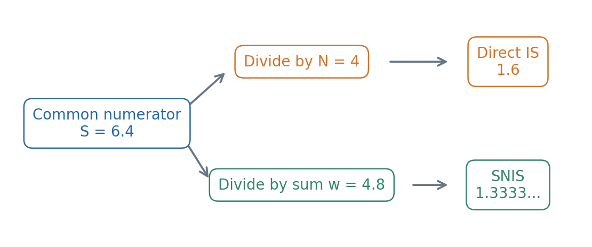

**F05. Read the denominator labels before the final numbers.** The numerator is shared; the definitions differ.

**Equation E04.1. Two estimates**

$$
\widehat\mu_{\mathrm{IS}}=\frac1N\sum_iw_i z^{(i)}
=\frac{6.4}{4}=1.6,
$$

$$
\widehat\mu_{\mathrm{SNIS}}
=\frac{\sum_iw_i z^{(i)}}{\sum_iw_i}
=\sum_iW_i z^{(i)}
=\frac{6.4}{4.8}=\frac43.
$$

There is no extra division by $N$ after the normalized-weight sum. The weights $W_i$ already sum to one.

### S04 continued · Why the definitions differ

With a known normalized target and suitable support,

$$
\mathbb E_q\!\left[g(z)\frac{p(z)}{q(z)}\right]
=\sum_z q(z)g(z)\frac{p(z)}{q(z)}
=\sum_zg(z)p(z).
$$

The direct-IS estimator is the sample average of this weighted function. For iid proposal draws with an integrable weighted function, its expectation is the target expectation.

SNIS divides an estimated weighted numerator by an estimated weight mass. A common scale factor in all raw weights cancels in this ratio. This is useful when only an unnormalized target is known. The finite-sample ratio is not generally unbiased.

| Calculation | Entries being summed | Denominator in this example |
|---|---|---|
| Exact target expectation | Each support state with its target mass | Target is already normalized |
| Direct IS | Each of the four proposal draws | Draw count $4$ |
| SNIS | Each of the four weighted draws | Raw-weight mass $4.8$ |

For these particular draws, the two estimates differ from $1.3$. Their proximity to the exact answer in one fixed example does not establish a universal ranking of estimators.

**Fill before checking code:** “I use the denominator ___ because the expression is a ___.” Name the estimator and its assumptions, rather than choosing a denominator because it gives a convenient value.

**Transfer to original Q3(b):** separate the exact target sum from the two draw-based estimates. Reuse the numerator only when the draw order, target and proposal are the same.

## S05 — Weight ESS and Repeated Draws

**Equation E05.1. Weight concentration**

$$
N_{\mathrm{eff}}^{\mathrm{weight}}
=\frac1{\sum_{i=1}^{N}W_i^2}.
$$

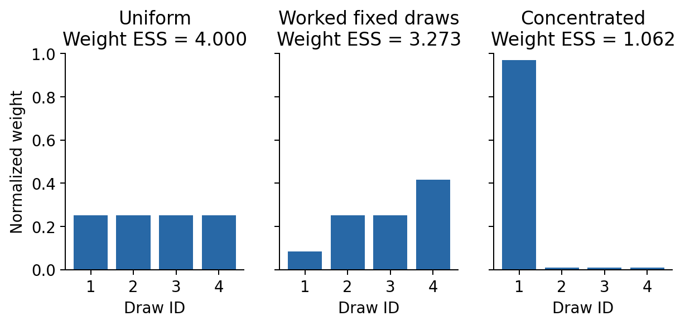

**F06. Read:** concentration increases from the first to the last panel. The bars refer to draw IDs, not unique state labels.

For the worked four-draw case,

$$
\sum_iW_i^2
=\left(\frac1{12}\right)^2
+\left(\frac14\right)^2+\left(\frac14\right)^2
+\left(\frac5{12}\right)^2
=\frac{11}{36},
$$

$$
N_{\mathrm{eff}}^{\mathrm{weight}}
=\frac{36}{11}\approx3.2727.
$$

Equal weights give $N$; a single positive normalized weight gives 1. These bounds are useful checks. Merging the repeated state into one bar changes the object whose concentration is measured.

Weight ESS does not detect a target region never visited by the proposal. It is also different from an MCMC ESS based on serial autocorrelation. State what kind of ESS is being reported.

**Transfer to original Q3(c):** square the four normalized weights from that question, sum all four terms and invert once. Preserve an exact fraction until the final decimal.

## S06 — From Likelihood to Gaussian NLL

Let observations be conditionally independent given candidate means $\mu_i$ and a common known variance $\sigma^2>0$. The likelihood is a product of densities:

$$
p(\mathbf y\mid\boldsymbol\mu,\sigma^2)
=\prod_{i=1}^{n}
\frac1{\sqrt{2\pi\sigma^2}}
\exp\!\left[-\frac{(y_i-\mu_i)^2}{2\sigma^2}\right].
$$

Taking a negative natural logarithm changes products into sums.

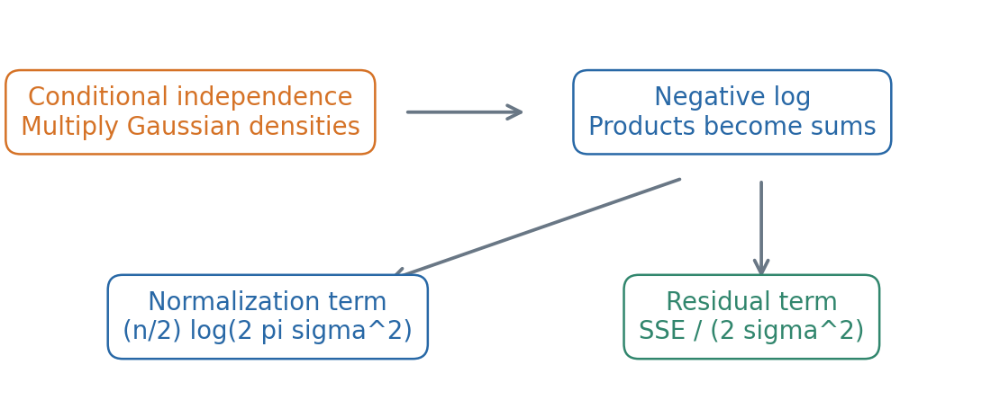

**F07. Read:** density product → negative log → two retained terms.

**Equation E06.1. Summed Gaussian NLL**

$$
\mathrm{NLL}
=\frac n2\log(2\pi\sigma^2)
+\frac1{2\sigma^2}\sum_{i=1}^{n}(y_i-\mu_i)^2.
$$

The first term normalizes the density. The second scales the sum of squared errors. This is a **sum**, not an average NLL.

If models use the same observations and variance, the common normalization term cancels in an NLL difference. If variances differ, retain their different terms; an SSE comparison alone does not establish the NLL ranking.

### S06 continued · Residuals, SSE, MSE and shapes

Reuse the W7 teaching case: $y=(1,2)$, $\mu=(1.5,1.5)$, variance $1$.

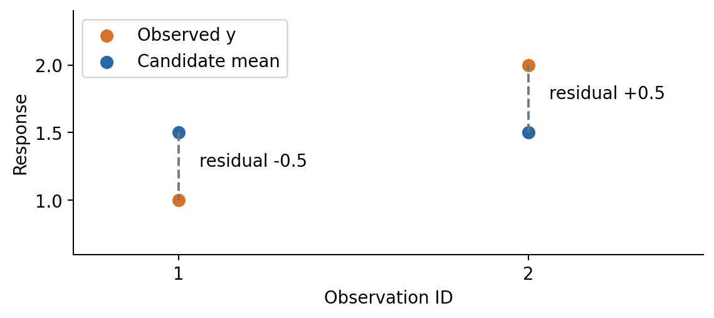

**F08. Read:** orange observation minus blue prediction gives the signed vertical residual. Square each residual before summing.

$$
\mathbf r=\mathbf y-\boldsymbol\mu=(-0.5,0.5),\qquad
\mathrm{SSE}=0.25+0.25=0.5,
$$

$$
\mathrm{MSE}=\frac{0.5}{2}=0.25,\qquad
\mathrm{NLL}=\log(2\pi)+\frac{0.5}{2}\approx2.087877.
$$

SSE sums squared errors; MSE divides by the observation count. NLL also includes a density normalization and a variance scale. None is an unbiased sample-variance calculation with denominator $n-1$.

In NumPy, a prediction array of shape $(n,1)$ and an observation array of shape $(n,)$ can broadcast to an $(n,n)$ difference. That matrix contains unintended cross-observation comparisons. Our strict wrapper requires matching one-dimensional arrays and rejects this error.

**Notebook E3:** inspect both shapes and repair the supplied prediction array. Compute one residual per observation. An error message is useful evidence; do not suppress it by averaging an unintended matrix.

## S07 — Residuals and Matched Runs

Residual calculations use observation IDs. A separate experiment table uses **run IDs**. Revisit the matched-condition comparison introduced in the W3 research-methodology supplement; do not treat its recorded errors as residuals from the preceding example.

| A run ID | A error | B run ID | B error |
|---|---:|---|---:|
| r1 | 0.2 | r3 | 0.2 |
| r2 | 0.6 | r1 | 0.6 |
| r3 | 0.4 | r2 | 0.4 |

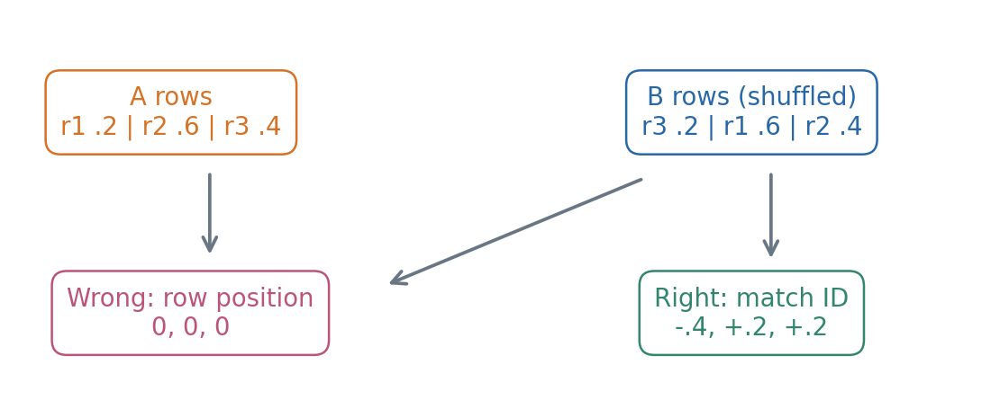

**F09. Read:** B's rows are shuffled. Subtracting row positions produces three zeros. Matching IDs produces a different vector.

Define $d_i=e_{A,i}-e_{B,i}$ after matching the same run. Lower error is better, so positive $d_i$ favors B.

$$
(d_{\mathrm{r1}},d_{\mathrm{r2}},d_{\mathrm{r3}})
=(0.2-0.6,\;0.6-0.4,\;0.4-0.2)
=(-0.4,\;0.2,\;0.2).
$$

Validate unique IDs and exactly the same ID set in both tables. Silently dropping unmatched runs changes the comparison.

### S07 continued · Summary statistics do not prove alignment

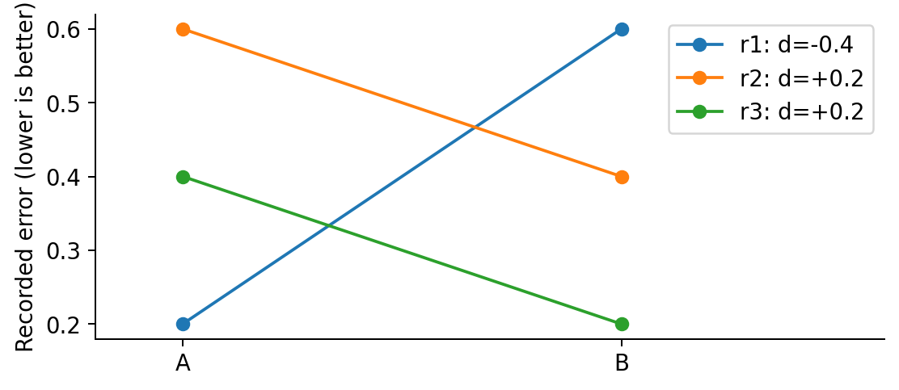

**F10. Read one line per run.** r1 favors A; r2 and r3 favor B. A tie is not a win.

The correctly matched mean difference is

$$
\bar d=\frac{-0.4+0.2+0.2}{3}=0.
$$

The incorrect row-position calculation also has mean zero. More generally, using every value once gives

$$
\frac1n\sum_i(e_{A,i}-e_{B,\pi(i)})
=\bar e_A-\bar e_B
$$

for any permutation $\pi$. A plausible mean cannot establish correct pairing. Win counts can also coincide accidentally. Check the full **ID-labelled difference vector**.

A positive mean describes average improvement for these matched records. It does not imply improvement on every run, a statistically significant result, or performance on an unobserved population.

**Transfer to original Q4:** first derive the loss with its own observations and variance. For the separate records in part (c), rebuild the A/B table by run ID before computing any differences.

**Notebook E4:** predict the complete aligned vector, then use the keyed join to check each element. Keep the input table order and the run identity distinct.

### Guided transfer to original Q4 · Keep two experiments separate

Use the workbook's observation vector, two candidate mean vectors and common noise variance for the likelihood calculation. Use its separate run-record table for the paired comparison. An observation ID in a residual table and a run ID in a repeated-experiment table identify different units; neither table can replace the other.

Before substituting numbers, fill this structure on paper:

| Likelihood calculation | Your expression or check |
|---|---|
| Number of observations | ______ |
| Common variance, and its corresponding SD | ______ |
| Residual vector for each candidate | ______ |
| Shared normalization constant in the summed NLL | ______ |
| Candidate-dependent squared-error term | ______ |

For the run table, copy the original IDs into three rows in one fixed order. Locate each candidate's error by its ID, then write the signed difference. Finally report the mean, wins and ties. Verify every ID-specific difference before using a summary: a matching average alone cannot establish correct pairing. Keep the two candidate labels attached to every result.

**Partner check:** explain which changes would invalidate the shared-constant argument for the NLL comparison. Then explain why an arbitrary permutation of one run table can leave a mean difference unchanged even when its individual pairs are wrong. Give the reason, without replacing your actual ID matching by a guess.

## S08 — From Prior Precision to Posterior

Return to one unknown shared slope, with no intercept:

$$
w\sim\mathcal N(0,\tau^2),\qquad
y_i=x_iw+\epsilon_i,\qquad
\epsilon_i\overset{\mathrm{ind}}{\sim}\mathcal N(0,\sigma^2).
$$

The noise variables are independent of the weight. Both variances are known and positive. The posterior shape is obtained from prior times likelihood.

$$
p(w\mid D)\propto
\exp\!\left[-\frac12\left\{
\frac{w^2}{\tau^2}
+\sum_i\frac{(y_i-x_iw)^2}{\sigma^2}
\right\}\right].
$$

Collect the quadratic coefficients:

$$
a=\frac1{\tau^2}+\frac{\sum_i x_i^2}{\sigma^2},
\quad b=\frac{\sum_i x_i y_i}{\sigma^2},
\quad c=\frac{\sum_i y_i^2}{\sigma^2}.
$$

The expression inside braces is $aw^2-2bw+c$. Distinguish the quadratic coefficient from the coefficient of $w$, which is $-2b$.

For the W7 teaching case, use $\tau^2=1,\sigma^2=1,D=\{(1,1),(2,2)\}$:

$$
w^2+(1-w)^2+(2-2w)^2=6w^2-10w+5.
$$

Before recognizing a Gaussian, complete the square or perform the equivalent precision update.

### S08 continued · Complete the square and read the Gaussian

$$
6w^2-10w+5
=6\left(w-\frac56\right)^2+\frac56.
$$

The last term is constant in $w$ and is absorbed into the posterior normalizer. Comparing the remaining exponent to $-(w-m)^2/(2S)$ gives

$$
w\mid D\sim\mathcal N\!\left(\frac56,\frac16\right).
$$

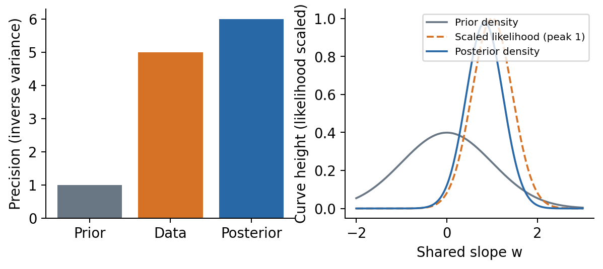

**F11. Read the precision bars, then the curve legend.** The dashed likelihood has been scaled to peak 1; it is not itself a normalized posterior density.

The posterior mean is the center of the completed square. The coefficient 6 is the **precision**, so the posterior variance is $1/6$, not 6.

A constant in $w$ can be absorbed when identifying a posterior shape. Reporting a full Gaussian NLL in S06 instead requires its density normalization. These are different requested calculations.

**Check:** the posterior variance $1/6$ is smaller than the prior variance 1. Does a weight estimate alone communicate this remaining uncertainty?

### S08 continued · The equivalent precision calculation

**Equation E08.1. Zero-mean-prior precision update**

$$
S^{-1}=\tau^{-2}+\sigma^{-2}\sum_i x_i^2,
\qquad m=S\,\sigma^{-2}\sum_i x_i y_i.
$$

| Contribution | Precision contribution | Information contribution |
|---|---:|---:|
| Prior $N(0,1)$ | 1 | 0 |
| Observation $(1,1)$, variance 1 | $1^2=1$ | $1(1)=1$ |
| Observation $(2,2)$, variance 1 | $2^2=4$ | $2(2)=4$ |
| Total | 6 | 5 |

Thus $S=1/6$ and $m=(1/6)5=5/6$, agreeing with square completion.

Input magnitude enters precision through $x_i^2$. The response enters information through $x_i y_i$. With this known-noise model and fixed inputs/scales, changing responses changes the mean but not the posterior variance.

If the noise SD is halved, the noise variance is quartered and each data precision contribution is multiplied by four. Do not divide by the SD where the formula requires its square.

The reusable fitting API receives a feature matrix of shape $(n,1)$, and its noise argument is an SD. The strict scalar wrapper makes these assumptions explicit and cross-checks the existing fitting API.

**Transfer to original Q5(a):** copy its actual prior variance and data into your own calculation. Identify prior precision, data precision and information separately. Show either a complete square or the full precision update.

## S09 — Latent Function vs New Response

Let $w\mid D\sim\mathcal N(m,S)$ and $f_*=x_*w$. A new response has independent new noise $\epsilon_*\sim\mathcal N(0,\sigma^2)$.

**Equation E09.1. Two prediction queries**

$$
\mathbb E[f_*\mid D]=x_*m,\qquad
\operatorname{Var}(f_*\mid D)=x_*^2S,
$$

$$
\mathbb E[y_*\mid D]=x_*m,\qquad
\operatorname{Var}(y_*\mid D)=x_*^2S+\sigma^2.
$$

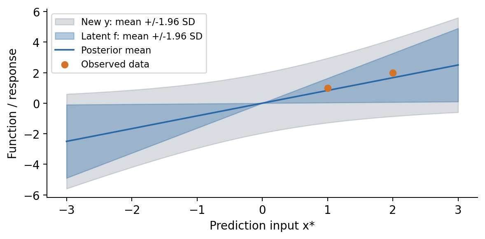

**F12. Read the blue latent band first, then the gray new-response band.** The shaded intervals are pointwise Gaussian mean $\pm1.96$ SD.

For the worked posterior and $x_*=3$, the latent mean is $3(5/6)=2.5$, its variance is $3^2(1/6)=1.5$, and the new-response variance is $1.5+1=2.5$.

The variance difference is exactly the new noise variance. Do not add standard deviations or add the same noise variance twice.

At $x_*=0$, the no-intercept latent function is exactly zero, while a new response still has noise variance. Reusing a training input also specifies a **new** response when new independent noise is part of the query.

### S09 continued · Simulation accuracy and predictive uncertainty

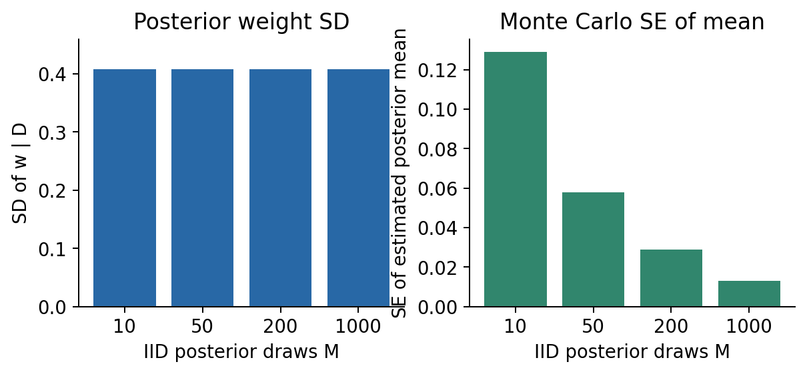

**F13. The two panels refer to different objects.** One describes a distribution; the other describes numerical estimation of its mean.

If $w^{(1)},\ldots,w^{(M)}$ are iid draws from this fixed posterior, then

$$
\operatorname{SD}(w\mid D)=\sqrt S,\qquad
\operatorname{SE}\!\left(\frac1M\sum_j w^{(j)}\right)=\sqrt{\frac S M}.
$$

The posterior itself does not become more certain because we simulate more draws. With fixed data and model, $m,S$ and the exact prediction formulas remain unchanged.

For dependent samples, the iid standard-error formula needs adjustment. Likewise, weight ESS from S05 is not automatically an MCMC ESS.

**App comparison:** keep all data, scales and prediction input fixed. Change only the number of iid posterior draws. Identify the exact results that should stay constant and the Monte Carlo quantities that can change.

**Transfer to original Q5(b):** distinguish the already observed response from the new response named in the question. Multiply the posterior weight variance by the squared input, then add one new independent noise variance.

### Guided transfer to original Q5 · State the conditioning and the query

Keep the workbook open beside the following structure. Write its prior variance and noise variance first, then name their reciprocals. The prior variance concerns the unknown weight; the noise variance concerns the observation model. They enter different places even when their numerical values happen to agree in another problem.

| Stage | Complete symbolically before inserting the original data |
|---|---|
| Prior contribution | prior precision = ______ |
| Data contribution | likelihood precision = ______; information = ______ |
| Posterior | precision = ______; mean = ______; variance = ______ |
| Latent query at the specified input | mean = ______; variance = ______ |
| A new response at that same input | mean = ______; variance = ______ |

Check the posterior by completing the square and by adding precisions. The two routes must describe the same distribution. For the predictive query, identify the multiplier of the random weight before applying the variance rule; a negative input changes the sign of a mean but does not create a negative variance.

Finish by writing a separate sentence for each query: what is random, what is conditioned on, and what new independent noise is present? The kernel question asks for the prior function covariance, so return to the prior weight variance there. Do not carry the posterior variance into a formula that explicitly asks about the model before observing data.

## S10 — From Random Weights to a Kernel

A function draw is a jointly defined collection of values. In our scalar example, one draw of $w$ determines all values $f(x)=xw$.

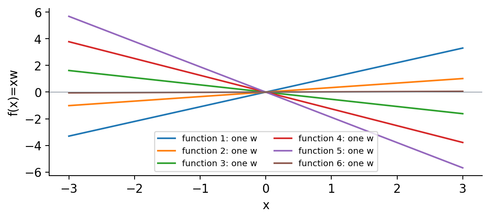

**F14. Trace one line across all inputs.** Its weight is shared. Independently redrawing a weight at every location would remove this joint function construction.

**Equation E10.1. Prior function covariance**

$$
k(x,x')=\operatorname{Cov}(xw,x'w)
=xx'\operatorname{Var}(w)
=\tau^2xx'.
$$

Before observing data, use the **prior** weight variance $\tau^2$. After conditioning on data, the scalar posterior function covariance is $Sxx'$. Neither expression includes new observation noise.

For the non-exam prior $\tau^2=1$, inputs $(-2,1)$ have covariance $-2$. Increasing a positive slope moves the two function values in opposite directions. Their individual variances remain nonnegative.

**Transfer to original Q5(c):** the phrase “before observing $D$” determines which weight variance to use. Write the shared-weight covariance derivation before substituting the requested inputs.

### S10 continued · Positive semidefiniteness and the book's GP panels

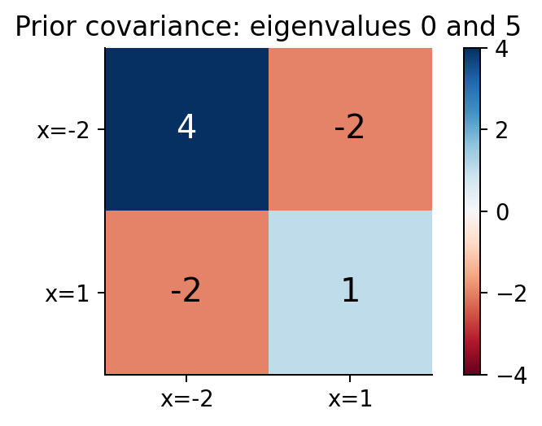

**F15.** A negative off-diagonal entry is compatible with PSD:

$$
\mathbf v^\top K\mathbf v
=\tau^2(\mathbf x^\top\mathbf v)^2\ge0.
$$

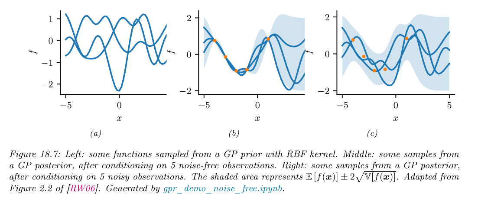

**F16. Source:** Murphy, *Advanced Topics*, Fig. 18.7, printed p. 694; original figure/caption retained from the verified W7 excerpt. The book uses an RBF kernel. Its shading is latent-function mean $\pm2$ SD, including in the noisy-training-data panel. The scalar worked case uses a rank-one linear kernel.

## S11 — Inference-to-Prediction Workbench

Run the independent CPU notebook from the top. Its small teaching data are created automatically. No personal-file upload, API key or GPU is required. Keep your prediction and explanation next to each calculation.

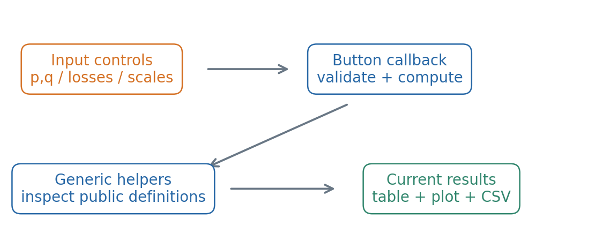

**F17. Follow the whole path.** Changing a widget value and interpreting a returned result are separate actions. CSV export recomputes and displays the current controls' results.

| Tab | Change or inspect | Explain |
|---|---|---|
| Importance weights | Target, proposal and fixed draw list | Draw count versus weight mass; repetitions and ESS |
| Loss and matched runs | Means/variance; separate run-ID records | Summed NLL versus MSE; ID-specific differences |
| Bayesian prediction | Prior variance, noise SD, query input and MC draws | Squared input scaling; one new noise variance; numerical error |

**Core notebook tasks:** E1 predict roles/weights; E2 fill denominator reasoning; E3 debug shapes; E4 align run IDs; E5 distinguish variances; E6 implement and connect your own diagnostic. The provided empty response fields do not block independent demonstrations.

For E6, edit your callback, then rebuild the app cell so the displayed result uses your function. Check two different inputs. An unfinished diagnostic is labeled explicitly; no completed answer is silently substituted. An optional extension compares a different diagnostic.

Use the [code guide](w10-code-guide.md) to inspect actual function definitions. The Colab shared app address lasts only while the runtime is active.

## S12 — Explain the Distinctions

Answer in words before returning to arithmetic.

1. How do a variational distribution and an importance proposal use the symbol q differently?
2. Why do direct IS and SNIS use different denominators?
3. Why must repeated draws remain separate in weight ESS?
4. When does a Gaussian NLL comparison reduce to an SSE comparison?
5. Why can a correct mean paired difference fail to prove correct run alignment?
6. Which uncertainty changes when posterior simulation draws increase?

The separate quiz-explanation PDF concerns these conceptual checkpoints. Use the original-question workbook to show your own work on all nine Q3–Q5 subparts. There is no new graded assignment or submission deadline.

**A final modeling check:** name the target distribution, the draw mechanism, the conditioning information and the precise future query. Then select the formula and verify its units, denominator and array dimensions.

### References and provenance

- Murphy, *Probabilistic Machine Learning: Advanced Topics*, supplied December 10, 2025 edition. Selected VI/MC/prediction/GP passages are documented in the course's source review. Figures 10.2 and 18.7 retain their original captions; raw textbooks are not included. [Official book page](https://probml.github.io/pml-book/book2.html).
- Earlier course notes: [W4 VI](../w4/w4-variational-inference.md), [W5 Monte Carlo](../w5/w5-monte-carlo-inference.md), [W6 inference rebuild](../w6/w6-inference-rebuild.md), [W7 prediction](../w7/w7-predictive-models.md).
- The discrete and scalar Gaussian worked cases reuse W5/W7 teaching examples. The shuffled-run counterexample, diagrams and workbench are teaching additions. They are distinguished from the original exam questions in the workbook.
- Prior pyprobml notebook inspection informed the design. Its upstream notebooks were inspected statically, not executed as evidence for this workbench. Runtime evidence concerns this course's implementation.
