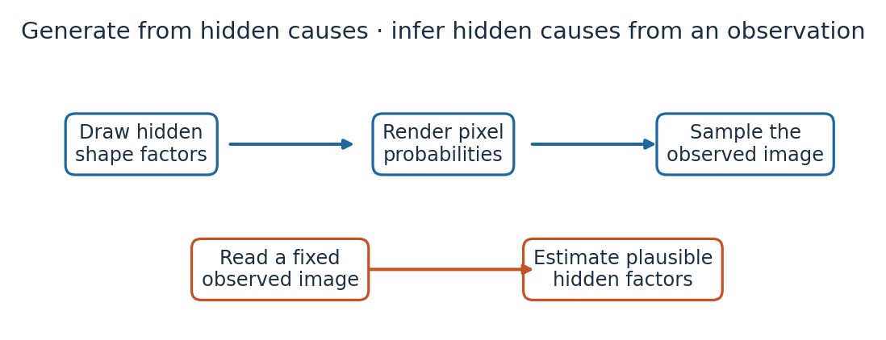
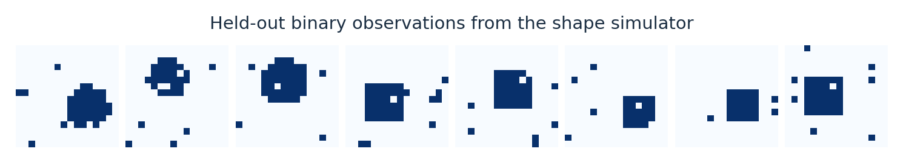
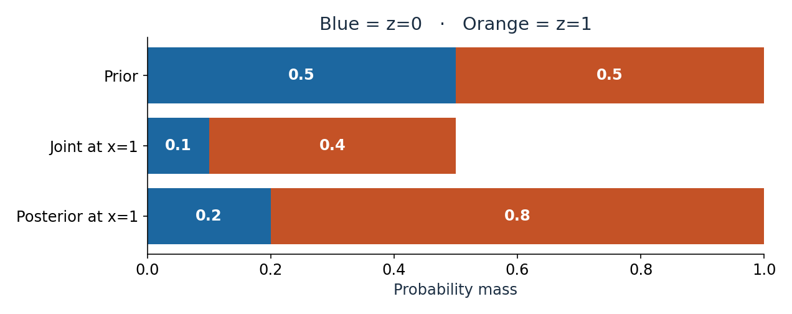
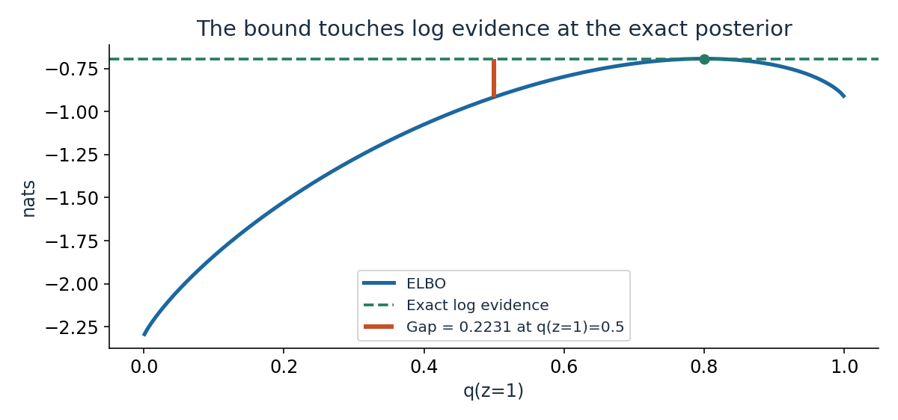
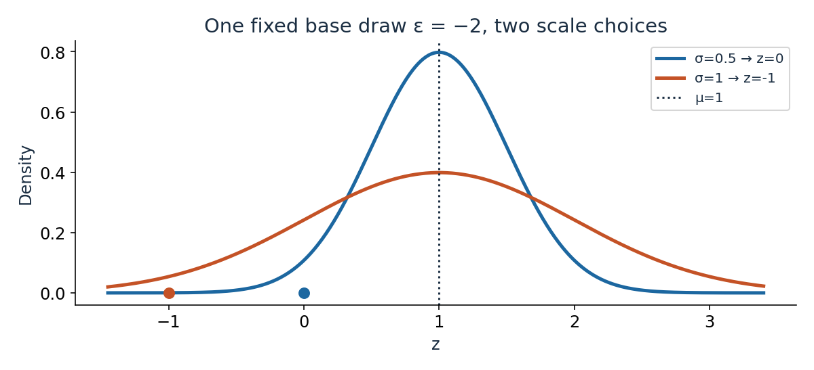
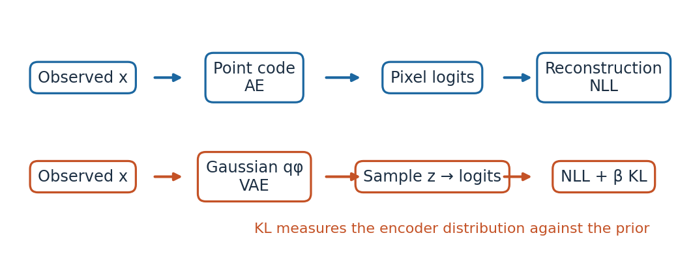
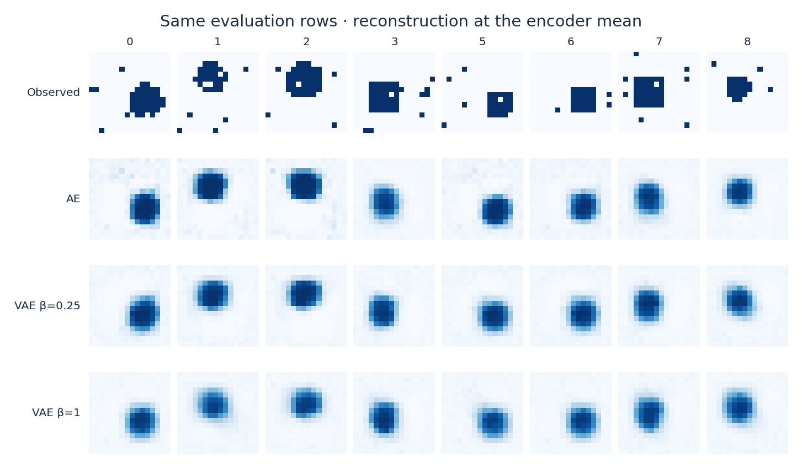
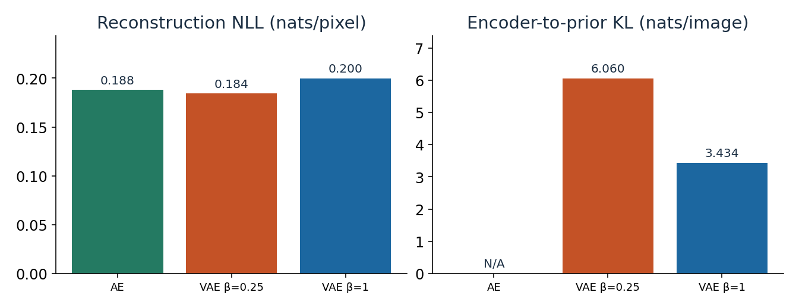
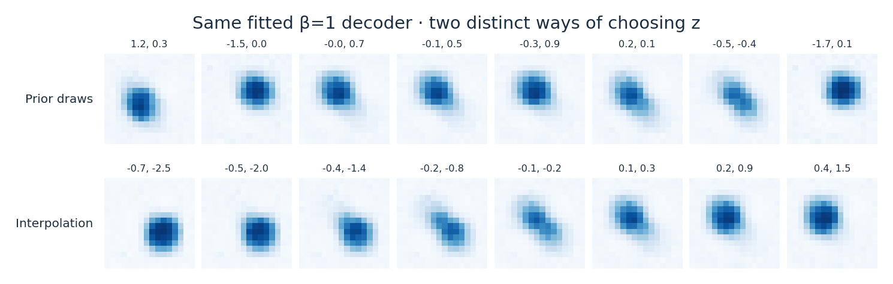
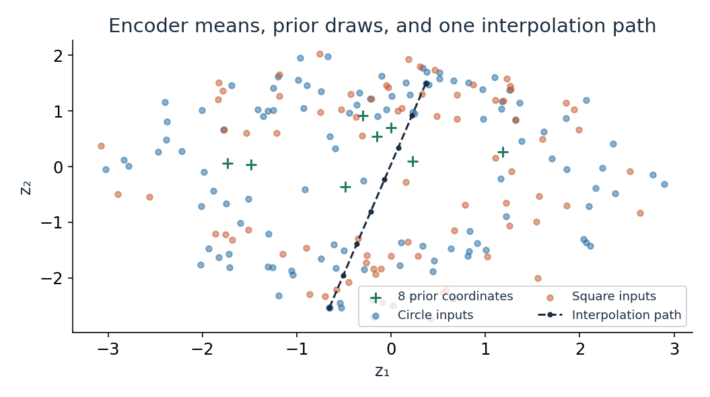

# Generative Models, Latent Variable Models, and Variational Autoencoders

**Advanced Machine Learning for Artificial Intelligence · W12 · November 17, 2026 · 13:00–15:00 KST**

By the end, compute one exact posterior and its ELBO gap, trace gradients through a Gaussian draw, and change a line in a VAE that you actually train. Use the section IDs to move between this note and the labs. The in-class work is formative.

[Colab A: exact calculations](https://colab.research.google.com/github/lunalab-ai/advML/blob/2026-fall-w12/notebooks/student/w12-a-exact-inference.ipynb) · [Colab B: train and explore](https://colab.research.google.com/github/lunalab-ai/advML/blob/2026-fall-w12/notebooks/student/w12-b-train-a-vae.ipynb)

## S01 — What Does a Generative Model Specify?

**Question.** What would the model need to know to draw a new image after training?

**Figure F01.** Generate by sampling causes and then pixels. Infer by conditioning on pixels already observed.

**Figure F06.** Each image has 256 observed binary pixels. In the simulator, shape, center and radius affect many pixels together. Cover an image, pick a center and shape, and predict where bright pixels will concentrate.

- \(x\) is the observation. \(z\) describes a hidden state for one observation. \(\theta\) is shared across images and controls the conditional decoder. When we learn an inference network, its shared parameters are \(\phi\).
- A probabilistic generative model assigns a distribution to data. One way to specify that distribution is to mix conditional distributions over hidden states. In our VAE, the prior and decoder let us both draw \(x\) and write a likelihood involving \(x\).
- Murphy's Chapter 20 places several generative model families side by side. The latent-variable route is the one used today. The Gaussian prior of the trained model need not reproduce the simulator's labeled shape factors.

## S02 — Generate, Marginalize, Infer

**E01 · Joint, evidence and posterior.** Choose a prior, then a conditional likelihood. Sum the joint over all hidden states. For a continuous latent, replace the sum with an integral.

$$
p_\theta(x,z)=p(z)p_\theta(x\mid z),\qquad
p_\theta(x)=\sum_z p(z)p_\theta(x\mid z),\qquad
p_\theta(z\mid x)=\frac{p(z)p_\theta(x\mid z)}{p_\theta(x)}.
$$

**Example 1.** A hidden switch takes either value with probability 0.5. The light turns on with probability 0.2 under \(z=0\), and 0.8 under \(z=1\). We observe the light on.

| Term | State 0 | State 1 |
| --- | ---: | ---: |
| Prior | 0.50 | 0.50 |
| Probability of light on given state | 0.20 | 0.80 |
| Joint mass for light on | 0.10 | 0.40 |
| State probability after observing light on | 0.20 | 0.80 |

The light is on in \(0.10+0.40=0.50\) of draws. Within those draws, the fraction from state 1 is \(0.40/0.50=0.80\). Here the two likelihood numbers also happen to sum to one. Their matching the posterior numerically is a property of this example. With prior \((0.75,0.25)\), the joint becomes \((0.15,0.20)\) and the two posterior masses are \(3/7\) and \(4/7\).

**Figure F02.** The middle bar has length 0.5. Divide each segment by that length to re-express the masses conditional on what was observed.

**Colab A · A01.** Change the prior to \((0.75,0.25)\). Predict both joint masses and check that normalizing recovers your posterior.

## S03 — Where Does the ELBO Gap Come From?

**E02 · Derive the evidence decomposition.** Start with the posterior KL. Replace the log posterior by the log joint minus the log evidence. The constant log evidence leaves the expectation intact because \(q\) integrates to one.

$$
\begin{aligned}
D_{\mathrm{KL}}(q\Vert p_\theta(z\mid x))
&=\mathbb{E}_q[\log q(z)-\log p_\theta(z\mid x)]\\
&=\log p_\theta(x)-\mathbb{E}_q[\log p_\theta(x,z)-\log q(z)]\\
&=\log p_\theta(x)-\operatorname{ELBO}(x;q,\theta).
\end{aligned}
$$

**E03 · Split the bound.** Factor the joint from E01 inside the expectation.

$$
\operatorname{ELBO}(x;q,\theta)
=\mathbb{E}_q[\log p_\theta(x\mid z)]-D_{\mathrm{KL}}(q\Vert p(z)).
$$

The KL in **E02** compares \(q\) to the **posterior** and measures how far the bound sits below log evidence. The one in **E03** compares \(q\) to the **prior** and is available in the Gaussian VAE loss. The posterior KL is nonnegative and vanishes at \(q=p_\theta(z\mid x)\) when this distribution is available in the variational family. During learning, a shared encoder supplies \(q_\phi(z\mid x)\) for each new image. This is amortized inference.

**Example 2.** With \(q=(0.5,0.5)\), the expected log likelihood is \(\tfrac12(\log 0.2+\log 0.8)=-0.916291\) nats. The prior KL is zero, so this is also the ELBO. The exact log evidence is \(\log 0.5=-0.693147\). The gap is \(0.223144\), equal to \(\tfrac12\log(0.5/0.2)+\tfrac12\log(0.5/0.8)\). Try \(q=(0.2,0.8)\). Its ELBO is \(-0.693147\), its posterior KL is zero, and its prior KL is about \(0.192745\).

**Figure F03.** The vertical gap at \(q(z=1)=0.5\) is the posterior KL in Example 2. At \(0.8\), the approximate posterior equals the exact one.

**Colab A · A02.** Predict where the orange gap will shrink as you vary \(q(z=1)\). Keep the generative model fixed. Check both KL values.

## S04 — From the Encoder to a Differentiable Draw

**E04 · Reparameterize.** An encoder produces a mean and a log variance for each latent coordinate. Draw standard Gaussian noise, then apply a differentiable location and scale transform. Keep this noise draw fixed when differentiating the sampled computation.

$$
\varepsilon\sim\mathcal N(0,I),\quad
\ell=\log\sigma^2,\quad \sigma=\exp(\ell/2),\quad
z=\mu+\sigma\odot\varepsilon.
$$

For a single coordinate, \(\partial z/\partial\mu=1\) and \(\partial z/\partial \ell=\tfrac12\exp(\ell/2)\varepsilon\). The expectation of the log likelihood in E03 can now be estimated by sampling \(\varepsilon\), evaluating the decoder and backpropagating through its input.

**Example 3.** \(\mu=1,\sigma=0.5,\varepsilon=-2\) give \(\ell=\log 0.25\), \(z=0\), and derivative \(-0.5\) with respect to \(\ell\). Using variance as scale would give \(z=0.5\). Increasing the scale from 0.5 to 1 with the same negative draw sends \(z\) to \(-1\).

**Figure F04.** The two dots are the same standard-normal draw viewed through two scales.

**Colab A · A03–A04.** Edit the scale line inside the function and compare the central difference to the analytic gradient. Keep the input \(\varepsilon\) unchanged across both evaluations.

## S05 — The VAE Objective and the AE Baseline

**Figure F05.** Follow x to logits on both rows. In the orange row the encoder is parameterizing a distribution, and the objective includes the KL of that distribution.

**E05 · Diagonal Gaussian to standard Gaussian.** For Example 3, one coordinate contributes \((1+0.25-1-\log 0.25)/2=0.818147\) nats. For two independent latent coordinates, add the two contributions.

$$
D_{\mathrm{KL}}\!\left(\mathcal N(\mu,\operatorname{diag}(\exp\ell))\Vert\mathcal N(0,I)\right)
=\frac12\sum_{j=1}^d(\mu_j^2+\exp\ell_j-1-\ell_j).
$$

**E06 · One-image training objective.** Pixels are conditionally independent Bernoulli observations given the code in this decoder. For each pixel, use its logit \(a_i\) and \(r_i=\operatorname{sigmoid}(a_i)\). Sum binary negative log-likelihood over pixels. Add the KL summed over latent coordinates. The optimizer averages these one-image totals across the minibatch.

$$
\widehat{\mathcal L}_{\beta}(x)
=\sum_{i=1}^{256}\big[-x_i\log r_i-(1-x_i)\log(1-r_i)\big]
+\beta\,D_{\mathrm{KL}}(q_\phi(z\mid x)\Vert p(z)).
$$

At \(\beta=1\), this one-draw loss estimates the negative ELBO. The AE baseline encodes to a point and uses only its reconstruction objective. A numerical check uses two zero logits and observations \((0,1)\). The negative log-likelihood is \(2\log 2\). With the Example 3 KL and \(\beta=1\), the combined one-image loss is \(2.204442\).

**Colab B · B01–B02.** Read the data shape and visible functions. Circle the pixel sum, the latent sum, and the batch mean. Run the two-pixel check.

## S06 — Train, Change One Line, and Compare

**Figure F07.** Column labels identify the same held-out examples used in each row. The three model rows decode the encoder mean. Look for spatial detail and uncertainty before reading the aggregates.

**Figure F08.** The VAE NLL averages four posterior draws per held-out image and is reported per pixel. The separate KL is per image. The AE NLL uses its point code.

**Colab B · B03–B04.** Fit the AE, \(\beta=0.25\) and \(\beta=1\) to the same 1,024 training images. Assess the same unseen 192 images. Make a prediction for \(\beta=4\). Change the displayed value, retrain the VAE and compare both columns with the \(\beta=1\) baseline. Keep the data, seed and epoch count fixed. Write one conclusion limited to this run and show which numbers support it. A higher KL weight changes the objective. The reconstruction effect is empirical and can vary with fit and data.

For a stronger check, deliberately change the pixel sum to a mean, rerun B02, and explain why the relative penalty became larger. Restore the sum before interpreting a controlled \(\beta\) comparison.

## S07 — Explore the Latent Space and Check the Claim

**Figure F09.** The top row starts with draws from the prior and uses no input image. The bottom row walks between codes inferred from two held-out images.

**Figure F10.** Each marker shows where one code came from. A visually smooth path says something about the fitted decoder between two points. Claiming a semantic meaning for an axis would require additional interventions and evidence.

**Colab B · B05–B06.** Compare a reconstruction, a prior draw and an interpolation. In the decoder explorer, move \(z_1\) while keeping \(z_2\) fixed. The mean panel shows pixel probabilities. The sampled panel shows one binary observation from them, using a fixed random seed for comparisons. Export the two tested coordinates and compare the maps as well as the CSV row. Per-image pixel means can hide spatial changes.

**Exit check.** If the average encoder-to-prior KL is close to zero, ask whether different inputs receive similar encoder distributions. Then vary \(z\) and inspect sensitivity of decoder outputs. These are diagnostics for collapse. State what you actually measured and what evidence would strengthen your diagnosis.

### Reading

Kevin P. Murphy, *Probabilistic Machine Learning: Advanced Topics* (MIT Press, 2023), registered online edition December 10, 2025. Use §§20.1–20.2 for the model map, §20.3 for sampling and interpolation, §§21.1–21.2 for the main model, §§10.1.5 and 10.2.1 for inference review, and §21.3.1 plus the opening of §21.4 for the experiment. The registered edition places §§21.1–21.2 on printed pp. 791–796. Figures F01–F10 here are original teaching illustrations and experiment outputs. [Author's book page](https://probml.github.io/pml-book/book2.html)

The reparameterized gradient and Gaussian VAE objective are developed in the original papers. [Kingma & Welling](https://arxiv.org/abs/1312.6114) · [Rezende, Mohamed & Wierstra](https://proceedings.mlr.press/v32/rezende14.html)
