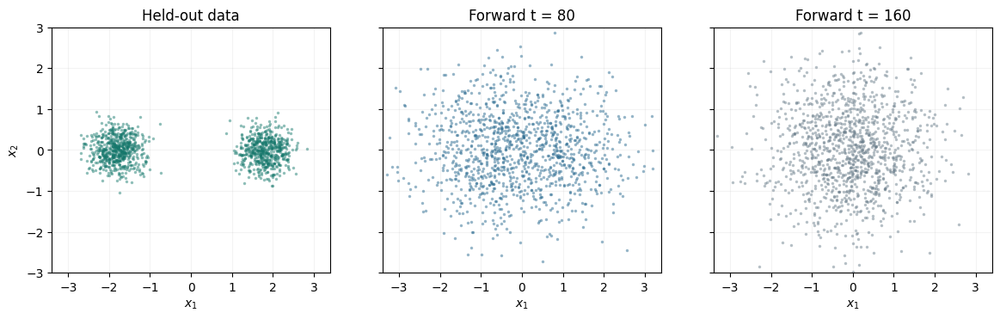
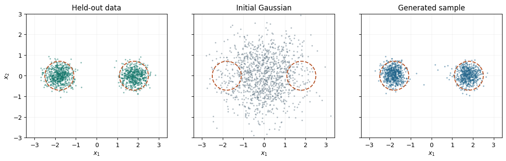

# From VAEs to Diffusion Models

Advanced Machine Learning for Artificial Intelligence · Week 13 · November 24, 2026

By the end of the lesson, derive the direct forward draw, identify the regression target, and explain how a learned denoiser specifies a reverse transition. Use the notebook to compare generated points with an independent held-out sample.

## From Gaussian reparameterization to a fixed forward chain

A Gaussian VAE uses $z=\mu_\phi(x)+\sigma_\phi(x)\odot\epsilon$, with $\epsilon\sim\mathcal N(0,I)$. The encoder learns the shift and scale. A DDPM applies a fixed Gaussian corruption to the data and learns a reverse model. Both constructions express a conditional Gaussian as a deterministic transformation of a standard Gaussian draw.

## The forward marginal

Let $\beta_t$ be the transition variance, $\alpha_t=1-\beta_t$, and $\bar\alpha_t=\prod_{s=1}^t\alpha_s$. In the forward process, independent $\eta_t\sim\mathcal N(0,I)$ give $x_t=\sqrt{\alpha_t}\,x_{t-1}+\sqrt{\beta_t}\,\eta_t$. For two steps, the signal coefficient is $\sqrt{\alpha_1\alpha_2}$ and the noise variance is $\alpha_2\beta_1+\beta_2=1-\alpha_1\alpha_2$. The same variance recursion holds at every step, yielding

$$
x_t=\sqrt{\bar\alpha_t}\,x_0+\sqrt{1-\bar\alpha_t}\,\epsilon,\qquad \epsilon\sim\mathcal N(0,I).
$$

The formula draws one marginal given $x_0$ at any chosen time. To simulate a full Markov path, apply the one-step transition with a fresh increment each time. As $\bar\alpha_t$ decreases, the component means move toward zero and the conditional noise spread grows.

## Training and reverse sampling

In training the algorithm samples a data point, a time, and a standard Gaussian noise vector. It forms $x_t$ and updates the network to minimize squared error between its prediction $\epsilon_\theta(x_t,t)$ and the sampled noise. The optimal population predictor under MSE is $\mathbb E[\epsilon\mid x_t,t]$. Here the MLP produces two noise coordinates and uses the time as an input. The simplified objective reweights intermediate variational terms relative to the original bound.

For generation, start with $x_T\sim\mathcal N(0,I)$ and iterate the reverse transition:

$$
\mu_\theta(x_t,t)
=\frac{x_t-\beta_t\epsilon_\theta(x_t,t)/\sqrt{1-\bar\alpha_t}}{\sqrt{\alpha_t}},
\qquad x_{t-1}=\mu_\theta(x_t,t)+\sigma_t z_t.
$$

The notebook uses the fixed variance $\sigma_t^2=\beta_t(1-\bar\alpha_{t-1})/(1-\bar\alpha_t)$. A fresh standard Gaussian $z_t$ provides step noise, and the final step has zero variance. The two Gaussian draws used in training and generation have different roles.

## CPU exercise

The notebook generates two isotropic Gaussian components centered at $(-1.8,0)$ and $(1.8,0)$. It uses 4,096 training points and a separately seeded set of 1,200 held-out points. Change the forward time before rerunning the first scatter plot. For the reverse experiment, start from an independently seeded standard Gaussian sample of size 1,200.

The diagrams use identical axes. A point counts toward a mode when it is within radius 0.70 of its center. Count both modes and the outside points. This diagnostic checks two regions of this known synthetic distribution and leaves features such as within-mode shape to the plot.

For the final discussion, fix the current state and time and compare two reverse draws. Run the same check at time 1. The exercise is formative.

## Formative checkpoints

1. Which parameters does the VAE encoder learn in the Gaussian example?
2. Which variance appears in a direct draw of the forward marginal?
3. Which quantity supplies the supervised label for the noise predictor?
4. Why can two reverse samples from a shared state differ?
5. What could a pooled count across both circles conceal?

## Reading

- Kevin P. Murphy, [Probabilistic Machine Learning: Advanced Topics](https://probml.github.io/pml-book/book2.html), §25.1–25.2.
- Jonathan Ho, Ajay Jain, and Pieter Abbeel, [Denoising Diffusion Probabilistic Models](https://arxiv.org/html/2006.11239#S3), §3, Algorithms 1–2.
