# From Predictive Models to Bayesian Functions

**Advanced Machine Learning · W7 · Tuesday, October 13, 2026 · 13:00–15:00 KST**

If the earlier inference lessons still feel unfamiliar, begin here. We use one question throughout: **after seeing these observations, what could the response at a new input be?** We first make the objects visible, then calculate a small example, and only then use the general formula. You do not need to memorize a large catalog of models today.

[Worked calculations](w7-worked-calculations.md) · [Experiment worksheet](w7-experiment-record.md) · [Code and API guide](w7-code-guide.md) · [Lab A: predictive models](https://colab.research.google.com/github/lunalab-ai/advML/blob/2026-fall-w7/notebooks/student/w7-a-predictive-models.ipynb) · [Lab B: Bayesian functions and web app](https://colab.research.google.com/github/lunalab-ai/advML/blob/2026-fall-w7/notebooks/student/w7-b-bayesian-functions.ipynb)

Both notebooks run independently on a CPU. Save a copy in Drive and run from the top. Supporting code and synthetic observations are prepared automatically. These are formative learning activities; no new graded assignment is introduced.

## Reading map and learning route

The main textbook is Kevin P. Murphy, *Probabilistic Machine Learning: Advanced Topics*. Page numbers below refer to the supplied **December 10, 2025 online version**, not necessarily the printed edition. This lesson connects selected sections; it does not attempt to cover five complete chapters in two hours.

| Learning question | Main textbook location | Depth today |
| --- | --- | --- |
| Why can a loss function come from a probability model? | 14.1–14.2, pp. 575–584 | Core interpretation |
| How do linear scores describe real, binary and count responses? | 15.1; 15.2.1–15.2.2; 15.3.1 | Core examples and Gaussian calculation |
| What changes with another link or related groups? | 15.1.2, p. 594; 15.4; 15.5, p. 625 onward | Brief extension map |
| What does a neural network add to the predictor? | 16.1–16.2; 16.3.1, p. 641 | Learned features and output heads |
| What is random in a Bayesian neural network? | 17.1–17.2; 17.3.5, pp. 654–655; 17.3.10, p. 661 | Core idea; last-layer approximation in lab |
| Can we reason directly about functions? | 18.1–18.2; 18.3.1–18.3.3, pp. 693–696; 18.3.6, p. 697 onward | Gaussian process regression |
| Why are wide networks connected to GPs? | 18.7.1, p. 729 onward | Closing connection, not a full proof |

Our 120-minute route is: name the objects (10), likelihood and loss (20), GLMs (15), neural predictors (15), Bayesian functions (20), GPs (20), web experiments (15), and an exit explanation (5). The derivation companion is available for slower review. The core outcomes are to explain an output distribution, distinguish three kinds of uncertainty, calculate a tiny posterior prediction, and support a model comparison with evidence.

## 1. Recover the objects before learning another algorithm

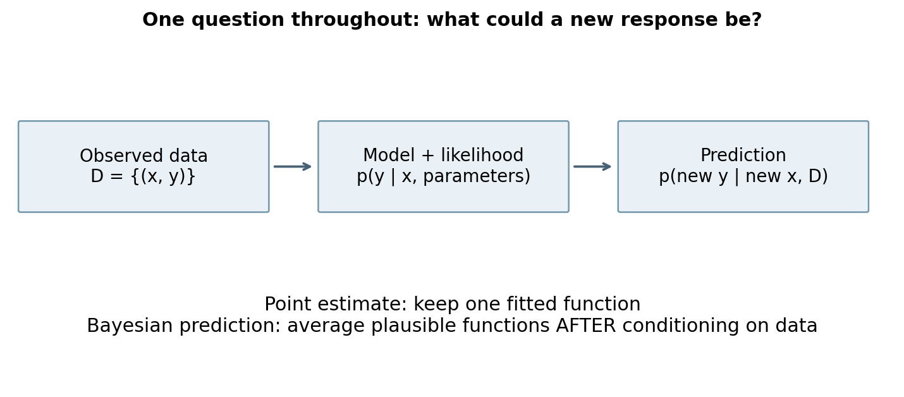

In Weeks 1–6 we repeatedly distinguished observed quantities from unknown quantities. That distinction still matters. Let the training data be $D=\{(x_i,y_i)\}_{i=1}^{n}$. Here $x_i$ is an input we observe, and $y_i$ is its observed response. A new input $x_*$ is given to us, but its response $y_*$ has not yet been observed. The subscript star means “new case,” not multiplication.

A parameter vector $\theta$ specifies a model. For example, it may contain the intercept and slope of a line or all weights of a neural network. The function $f_\theta(x)$ maps an input to a numerical score. A conditional distribution $p(y\mid x,\theta)$ tells us how responses can vary around or according to that score. The score is not automatically a probability: we must choose an appropriate output distribution and parameter transformation.

In our regression simulator,

$$
f(x)=\sin(1.5x)+0.25x,\qquad y=f(x)+\epsilon,\qquad \epsilon\sim\mathcal N(0,\sigma^2).
$$

The solid or dashed curve representing the simulator is available only to evaluate the experiment. The fitted models receive training pairs, not the true formula. Training inputs avoid the interval $(-0.6,0.6)$ and lie within $[-3,3]$. We evaluate on a separate grid extending to $[-4,4]$. This creates a gap and an extrapolation region where assumptions become visible.

**Read the symbols aloud:** $y$ is a noisy observation; $f(x)$ is a latent function value; $\theta$ is a model parameter. A simulated parameter draw is not an additional observed training case.

**Q1. Does drawing more posterior functions give us more observed training examples?**

## 2. A prediction can be a distribution

A point prediction supplies one number, such as 1.5. A predictive distribution describes which response values are plausible and how spread out they are. A Gaussian prediction can have mean 1.5 and standard deviation 0.2, or the same mean and standard deviation 2.0. The point predictions coincide, but the uncertainty statements are very different.

There are two distinct operations:

$$
\hat\theta=\arg\max_\theta p(D\mid\theta),\qquad
p(y_*\mid x_*,\hat\theta),
$$

and

$$
p(\theta\mid D)\propto p(D\mid\theta)p(\theta),\qquad
p(y_*\mid x_*,D)=\int p(y_*\mid x_*,\theta)p(\theta\mid D)\,d\theta.
$$

The first fits one parameter vector and conditions on it. It can still produce an output distribution, but it does not integrate parameter uncertainty. The second updates a prior over parameters and averages their conditional predictions. The integral says “combine predictions from plausible parameter settings, weighted by their posterior density.” It does not say “average all parameters and then run the network.” For a nonlinear function these operations usually differ.

The probability model makes a statement under its assumptions. A probabilistic output does not by itself establish calibration, robustness to distribution shift, or scientific validity. Those require evaluation and model checking.

## 3. From likelihood to a training loss

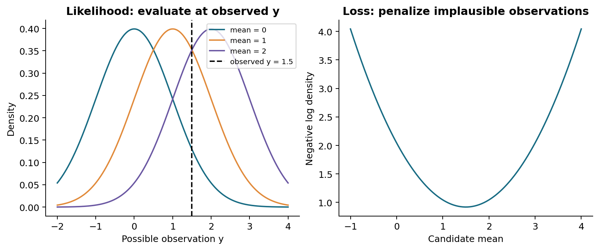

Hold the observation fixed. For each candidate parameter setting, ask how much probability mass or density the model assigns to what we observed. For conditionally independent responses, multiply those contributions. Taking a logarithm changes a product into a sum; placing a minus sign in front gives a quantity to minimize.

For Gaussian regression with a **fixed positive variance**,

$$
p(y_i\mid x_i,\theta)=\mathcal N(y_i\mid f_\theta(x_i),\sigma^2),
$$

$$
\operatorname{NLL}(\theta)=\frac n2\log(2\pi\sigma^2)+\frac{1}{2\sigma^2}\sum_{i=1}^{n}(y_i-f_\theta(x_i))^2.
$$

The first term is constant with respect to the mean parameters when $\sigma$ is fixed. The second term is a positive multiple of squared error. Therefore maximizing this likelihood and minimizing squared error select the same mean parameters. This argument changes if variance is also predicted: the log-variance term must remain. Simply making a predicted variance huge cannot be an unpenalized escape from a proper Gaussian NLL.

For observations $(1,2)$ and means $(1.5,1.5)$ with variance 1, the squared errors are $0.25$ and $0.25$. Their sum is $0.5$, their mean is $0.25$, and the **summed NLL** is approximately $2.087877$. These are related quantities, not identical numbers.

For binary labels $y_i\in\{0,1\}$ and predicted probabilities $p_i$,

$$
\operatorname{NLL}=-\sum_i[y_i\log p_i+(1-y_i)\log(1-p_i)].
$$

This is summed binary cross entropy. If the true label is 1, assigning probability 0.9 incurs less loss than assigning 0.1. If the true label is 0, it is $1-p_i$ that matters. Each case has its own Bernoulli distribution; probabilities for different cases need not add up to one.

**Q2. Under which condition does Gaussian negative log likelihood select the same mean parameters as squared error?**

In Lab A, calculate the individual contributions before calling the helper. Then deliberately change the assumed variance and see why the entire likelihood formula matters.

## 4. GLMs: keep the score simple, choose the output carefully

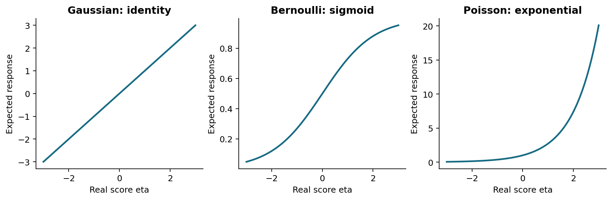

A generalized linear model has a response distribution, a linear predictor, and a link. With a feature vector $\phi(x)$,

$$
\eta=w^\top\phi(x),\qquad g(\mu)=\eta,\qquad \mu=g^{-1}(\eta).
$$

The **link** maps the mean to the score. The **inverse link** maps the score to the mean. For logistic regression, the logit is the link and the sigmoid is the inverse link. Reversing these names is a common source of confusion.

| Response | Conditional distribution | Inverse link | Meaning of the output |
| --- | --- | --- | --- |
| Real value | Gaussian with fixed variance | $\mu=\eta$ | Conditional mean |
| Binary label | Bernoulli | $\mu=(1+e^{-\eta})^{-1}$ | Probability of label 1 |
| Nonnegative count | Poisson | $\mu=e^{\eta}$ | Expected count, which need not be an integer |

For example, a Poisson score $\eta=\log 2$ gives expected count 2. An observed count may be 0, 1, 2, 3, or more. The expectation is not a deterministic output rule. A Bernoulli score 0 gives probability 0.5; that is uncertainty about a binary observation, not an observed label of 0.5.

Linearity refers to the parameters in $w^\top\phi(x)$. Fixed nonlinear features, such as $(1,x,x^2)$, can make the mean nonlinear in the original input while retaining linearity in the weights. When the features themselves are learned by a neural network, the overall predictor generally is no longer an ordinary fixed-feature GLM.

For canonical links, a useful per-case derivative of the negative log likelihood is proportional to $(\mu_i-y_i)\phi(x_i)$. It compares what the model expects with what was observed, then assigns that discrepancy to the features. Convexity of a canonical GLM objective does not alone guarantee a unique finite MLE: rank conditions and, for logistic regression, separation issues still matter.

**Q3. In logistic regression, which function is the link and which is the inverse link?**

## 5. What does “extensions of GLMs” mean?

We will recognize three extensions without trying to fit every version today.

**Another link.** Binary responses can use a probit inverse link $\mu=\Phi(\eta)$ instead of the logistic sigmoid. The response remains binary; the map from score to probability changes. A different link is not the same as a different response distribution.

**Another data-generating mechanism.** A Poisson distribution ties conditional variance to its mean. If zeros have an additional mechanism, a zero-inflated model introduces a probability $\rho$ of a structural zero, followed otherwise by a Poisson draw with rate $\lambda$. Thus

$$
P(y=0)=\rho+(1-\rho)e^{-\lambda},\qquad E[y]=(1-\rho)\lambda.
$$

The two ways to generate a zero must both be counted. This is a mixture extension, not merely a new link for an ordinary Poisson GLM. The model needs a substantive reason; observing a zero does not reveal which mechanism produced it.

**Related groups.** A multilevel GLM assigns a group-specific parameter $w_j$, with a shared distribution such as $w_j\sim\mathcal N(\mu,\tau^2I)$. Separate fits use little information across groups; complete pooling forces the groups to agree; partial pooling allows differences while sharing information. Small groups often shrink more strongly toward the shared pattern because their likelihood is less informative, conditional on the hierarchy and its inferred hyperparameters. This is not a rule that all group estimates become equal.

These extensions answer modeling questions: what can the output be, how can it vary, and what information should be shared? A more complex model is useful only if those choices address the problem and survive evaluation.

## 6. Neural networks learn features; the likelihood still matters

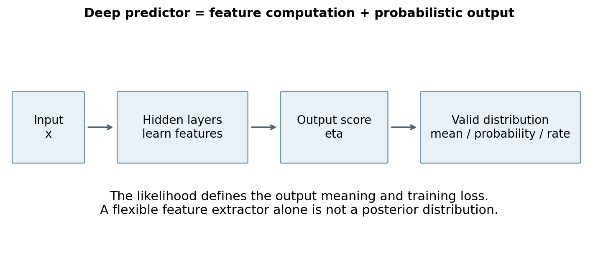

A neural predictor composes transformations. A small example is

$$
h(x)=\tanh(W_1x+b_1),\qquad \eta=W_2h(x)+b_2.
$$

More hidden layers compose further transformations. For regression, $\eta$ may be the Gaussian mean. For binary classification, a sigmoid converts it to a Bernoulli probability. For counts, an exponential can produce a Poisson rate. The network architecture and the output likelihood play different roles: one computes features and scores, while the other specifies the distribution of responses.

Our CPU lab uses a **small one-hidden-layer network** to make these roles inspectable. It is a teaching example of the same output-head principle used in deeper networks, not a large deep-learning benchmark. Its training objective is half the mean squared error plus a small squared-weight penalty. The optimizer status and objective change are reported; reaching a low training loss does not prove a global optimum or good extrapolation.

With fixed fitted weights, running the same input through this deterministic network repeatedly gives the same result. Randomly reinitializing networks creates different fits, but those fits are not automatically draws from a Bayesian posterior. We need a probabilistic inference argument for that claim.

**Q4. Does running the same deterministic fitted network repeatedly produce posterior samples?**

## 7. Bayesian neural networks: uncertainty over weights induces uncertainty over functions

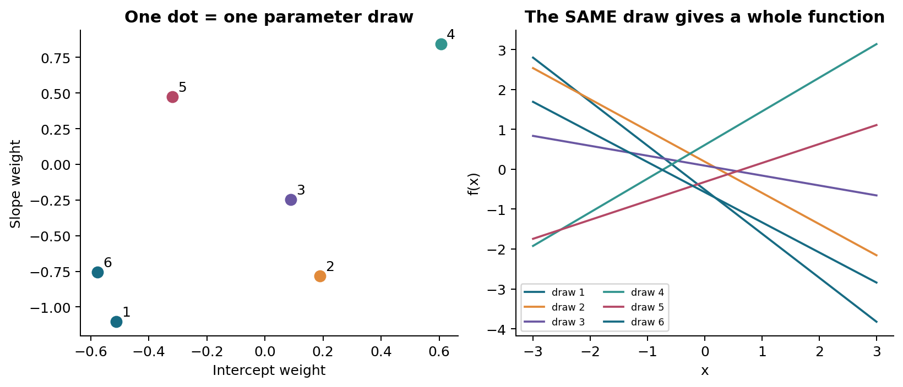

A Bayesian neural network places a prior $p(\theta)$ over network parameters and combines it with a likelihood. The posterior is

$$
p(\theta\mid D)=\frac{p(D\mid\theta)p(\theta)}{p(D)}.
$$

A weight draw gives an entire curve $x\mapsto f_\theta(x)$. We do not independently redraw its weights at every input when plotting a function sample. Using one draw across the grid preserves the relationships between predictions at different inputs.

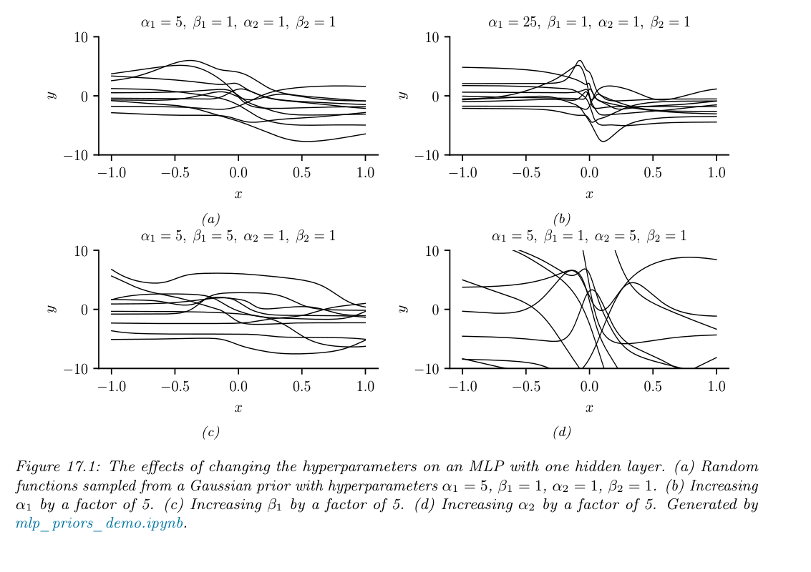

**Textbook figure:** Murphy, *Advanced Topics*, online version December 10, 2025, Figure 17.1, printed p. 649. The figure panels and original caption are reproduced as an unaltered excerpt. Read it in three passes: first notice that each panel contains several complete functions; then compare their variation; finally connect that variation to the prior settings named above each panel. These are **prior functions**, not learned posterior predictions. Our separate NumPy illustration uses tanh units and is an original qualitative demonstration, not an exact reproduction of the textbook's plotted curves.

Full-network inference is usually difficult. Variational inference chooses an approximate distribution $q(\theta)$; MCMC constructs samples targeting a posterior under its algorithmic assumptions. Our previous discussions of approximation, convergence and Monte Carlo error apply here. With approximate posterior draws,

$$
p(y_*\mid x_*,D)\approx\frac1S\sum_{s=1}^{S}p(y_*\mid x_*,\theta^{(s)}),\qquad \theta^{(s)}\sim q(\theta).
$$

There are two potential approximation gaps: $q$ may differ from the true posterior, and a finite sample average may differ from the expectation under $q$. More samples address the second, not automatically the first.

**Our tractable lab bridge:** train the hidden features once, freeze them, and use exact Bayesian linear regression for the final weights. This is the neural-linear or last-layer approximation in Section 17.3.5. Its posterior calculation is exact conditional on the frozen features, the prior and the known noise level. It omits uncertainty in learned hidden weights and should not be described as full BNN inference.

## 8. Separate noise, model uncertainty and numerical error

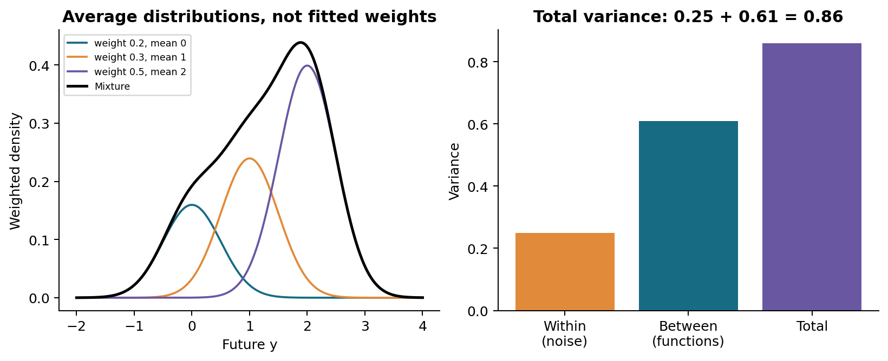

Suppose each parameter draw gives conditional mean $m_\theta(x)$ and conditional variance $v_\theta(x)$. The law of total variance gives

$$
\operatorname{Var}(y_*\mid x_*,D)=
\mathbb E_{\theta\mid D}[v_\theta(x_*)]+
\operatorname{Var}_{\theta\mid D}[m_\theta(x_*)].
$$

Read the first term as the **average within-model response variation**. Read the second as the **variation between plausible conditional means**. Under the fixed-noise regression model, the first is $\sigma^2$ and the second is uncertainty about the latent function. These are often called aleatoric and epistemic components, respectively, but their interpretation depends on the model and what we condition on.

A third quantity is **Monte Carlo error**: how much a finite-sample estimate changes because we used a finite computational budget. Increasing the number of independent posterior draws typically reduces this numerical error under finite-variance conditions. It does not erase response noise or supply new data. Correlated MCMC draws require an appropriate effective sample size, not simply the raw count.

In the finite-mixture example, weights $(0.2,0.3,0.5)$ and means $(0,1,2)$ produce mean 1.3. If every component has variance 0.25, the between-component variance is 0.61 and the total is 0.86. The companion walks through every multiplication. The mixture is not generally Gaussian, so mean plus or minus 1.96 standard deviations is not automatically its exact 95% interval.

**Q5. If we keep the data and posterior fixed but use more Monte Carlo draws, which uncertainty should decrease?**

## 9. A complete Bayesian calculation we can do by hand

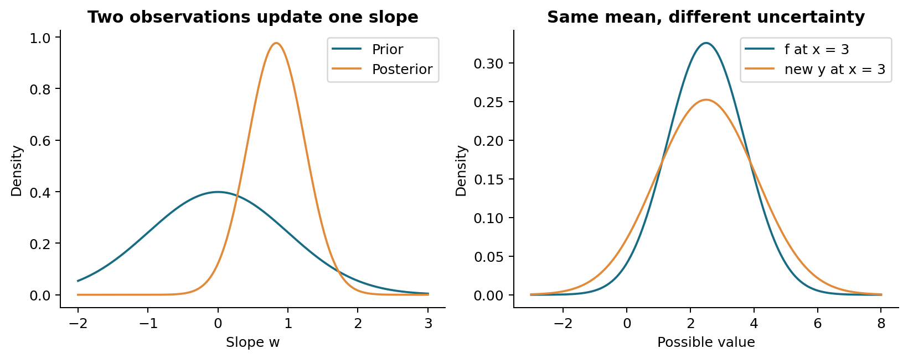

Begin with $w\sim\mathcal N(0,1)$ and $y_i=x_iw+\epsilon_i$, where independent noise has variance 1. Observe $(x,y)=(1,1)$ and $(2,2)$. The posterior precision is prior precision plus data precision: $1+1^2+2^2=6$. Its variance is $1/6$, and its mean is $(1\cdot1+2\cdot2)/6=5/6$.

At $x_*=3$, the latent function is $f_*=3w$. Therefore its posterior mean is $3(5/6)=2.5$ and its variance is $3^2(1/6)=1.5$. A future observation adds independent variance 1, giving predictive variance 2.5. Variances scale with the **square** of a multiplier; standard deviations do not add directly.

For a general design matrix $\Phi\in\mathbb R^{n\times d}$ and prior $w\sim\mathcal N(m_0,S_0)$,

$$
S=(S_0^{-1}+\sigma^{-2}\Phi^\top\Phi)^{-1},\qquad
m=S(S_0^{-1}m_0+\sigma^{-2}\Phi^\top y).
$$

At feature vector $\phi_*$,

$$
E[f_*\mid D]=\phi_*^\top m,\quad
\operatorname{Var}(f_*\mid D)=\phi_*^\top S\phi_*,\quad
\operatorname{Var}(y_*\mid D)=\phi_*^\top S\phi_*+\sigma^2.
$$

These formulas also power the last-layer lab after replacing hand-designed features with frozen learned features. Derivation details, dimensions and the square-completion step are in the companion.

## 10. A Gaussian process models functions directly

A Gaussian process is a distribution over functions such that their values at **any finite collection of inputs** have a joint Gaussian distribution. It is specified by a mean function and a covariance kernel:

$$
f\sim\operatorname{GP}(m,k),\qquad
(f(x_1),\ldots,f(x_n))^\top\sim\mathcal N(m_X,K_{XX}).
$$

“Gaussian” describes this joint distribution of function values. It does not mean that every sampled function is bell-shaped. The kernel specifies how values at different inputs vary together. A valid covariance matrix must be symmetric positive semidefinite: $a^\top Ka\geq0$ for every vector $a$. Individual covariance entries may be negative; entrywise positivity is not the general validity condition.

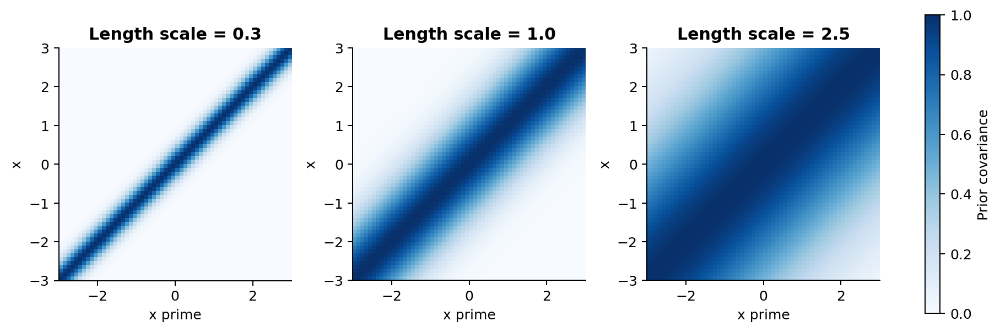

For the RBF kernel,

$$
k(x,x')=a^2\exp\left(-\frac{(x-x')^2}{2\ell^2}\right).
$$

The amplitude $a$ is a prior function standard deviation, and $a^2$ is the variance at one input. The length scale $\ell$ controls how rapidly correlation decays with input distance. A shorter length scale permits quicker local variation; a longer one ties more distant values together. Neither is automatically better. Units and input scaling change the interpretation of a length scale.

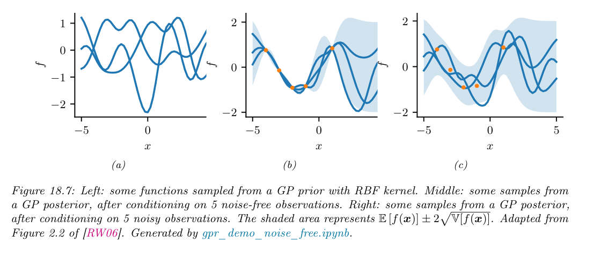

**Textbook figure:** Murphy, *Advanced Topics*, online version December 10, 2025, Figure 18.7, printed p. 694; unaltered figure-and-caption excerpt. First look at the left panel before any observations. Next notice how noiseless conditioning constrains the middle panel at observed inputs. Finally compare the right panel: noisy readings need not be interpolated exactly. The textbook shade is described as mean plus or minus **two** latent-function standard deviations; our own figures use 1.96 for pointwise Gaussian 95% intervals.

## 11. Condition a GP and check what its interval describes

Assume zero prior mean and known independent observation noise variance $\sigma^2$. Let $K$ be the training covariance, $K_{*X}$ the test-to-training covariance, and $K_{**}$ the test covariance. Set $C=K+\sigma^2I$. Gaussian conditioning gives

$$
m_*=K_{*X}C^{-1}y,\qquad
S_{f*}=K_{**}-K_{*X}C^{-1}K_{X*}.
$$

The mean starts from zero and changes through relationships with the observed data. The covariance starts from the prior covariance and subtracts information gained from conditioning. For new independent observations,

$$
S_{y*}=S_{f*}+\sigma^2I.
$$

For a single input, a pointwise Gaussian 95% interval is mean plus or minus $1.96\sqrt{v}$. Choose $v_f$ for the latent function and $v_y$ for a new response. A pointwise interval at each input is not a simultaneous 95% envelope for an entire curve. Hyperparameters are fixed here, so these intervals do not integrate uncertainty about the length scale or noise level.

With two inputs $(0,1)$, observations $(0,1)$, unit RBF amplitude and length scale, and noise SD 0.5, prediction at 0.5 has mean approximately 0.475347, latent variance 0.161015, and response variance 0.411015. The worked companion calculates the two-by-two system explicitly. The code solves the system through Cholesky factors instead of forming an inverse. Dense exact GP factorization costs $O(n^3)$ time and $O(n^2)$ storage; this CPU teaching dataset is deliberately small.

**Q6. Why is the interval for a future noisy observation wider than the interval for its latent function value?**

## 12. Weight space and function space describe the same model in a special case

If $f(x)=\phi(x)^\top w$ and $w\sim\mathcal N(0,S_0)$, then

$$
\operatorname{Cov}(f(x),f(x'))=\phi(x)^\top S_0\phi(x')=k(x,x').
$$

Any finite vector of function values is a linear transformation of Gaussian weights, so it is jointly Gaussian. Bayesian linear regression is therefore a GP with this feature-induced kernel. Lab B computes predictions once through the weight posterior and once through the kernel system. Their agreement is a test of an equivalence with **matching features, prior and noise**, not evidence that every GP is just a straight-line regression.

Certain increasingly wide random neural networks converge to GP priors when weights are independently initialized with appropriate scaling and regularity conditions. The output-weight variance scales inversely with width so that output variation remains controlled. This connects priors over weights with priors over functions. It does not mean every trained finite neural network is exactly a GP, nor that drawing random initial networks performs posterior inference.

**Q7. What must match when comparing weight-space and function-space predictions?**

## 13. Compare predictions without hiding failure

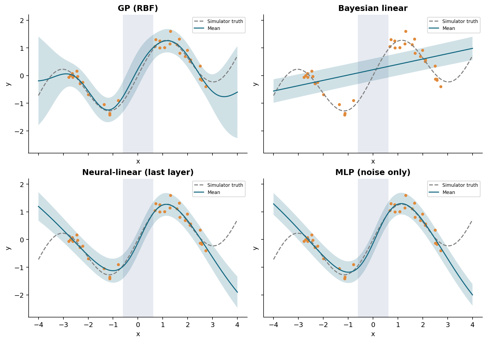

The original illustrative run uses 32 training observations, noise SD 0.2 and seed 19. Evaluation uses 241 independently generated held-out responses; no test outcomes are used for fitting or hyperparameter selection.

| Method | Held-out RMSE | Mean Gaussian NLL | Empirical 95% coverage |
| --- | --- | --- | --- |
| RBF GP, length scale 1 | 0.3798 | 0.1458 | 0.9710 |
| Bayesian straight line | 0.7246 | 5.5069 | 0.3278 |
| Neural-linear last layer | 0.7036 | 3.0780 | 0.7552 |
| Point MLP plus known noise | 0.7376 | 6.1094 | 0.7220 |

These are observed results from one controlled simulator and configuration, not a general model ranking. In particular, the straight-line model is structurally inappropriate for this nonlinear function. Its posterior can be narrow and still systematically wrong. The neural models' extrapolation behavior reflects their learned features and assumptions; a last-layer posterior cannot recover uncertainty that the feature representation omits.

RMSE evaluates the mean prediction. NLL evaluates the assigned density, including spread. Coverage counts how often outcomes fall inside the stated intervals; width shows how broad those intervals are. Very broad intervals may cover nearly everything and still be uninformative. A finite-grid coverage number near 0.95 does not prove population calibration. Compare the observed range, gap and extrapolation separately in the web app.

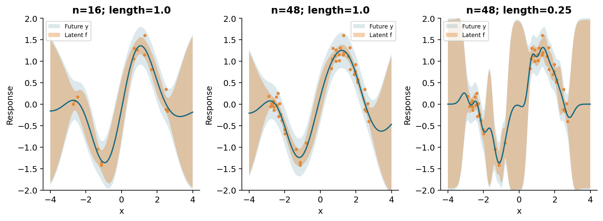

With a fixed Gaussian model, fixed noise and nested additional inputs, conditional latent variance cannot increase solely from adding observations. Posterior means and prediction error need not improve at every individual test point. Changing the kernel or re-estimating hyperparameters changes the assumptions, so it is a different comparison.

**Q8. Can a Bayesian model have narrow intervals and poor coverage? Explain one reason.**

## 14. Finish in the web workbench

Run Lab B to the final section. The web app lets you change the model, number of observations, noise SD, GP length scale and displayed interval. It reports region-specific held-out metrics, model assumptions and optimizer status, and exports a CSV.

1. Predict what will happen before touching a control.
2. Change only one setting for the first comparison. Keep data settings and seed fixed when comparing methods.
3. Read the latent-function and future-response bands separately.
4. Record two numerical differences and one visible difference.
5. Explain what the evidence supports and what it cannot establish.

The second tab turns a real score into a Gaussian mean, Bernoulli probability or Poisson rate and computes the corresponding one-observation loss. Try an invalid response, such as 0.5 for a Poisson count, and explain why the model rejects it. The notebook link is permanent; a generated Gradio share link lasts only while its runtime remains active.

**Exit explanation:** In four sentences, describe the observed data, the unknown object, how the posterior predictive is constructed, and one source of uncertainty your chosen model does not represent. Use a figure or an experimental number to support your explanation.

## Sources and reuse

The textbook supplies the terminology and model families; the small numerical examples, simulator, diagrams, code and exercises are original teaching additions. Selected textbook figure excerpts retain attribution and are used for this noncommercial class. Full textbook files are not redistributed.

- [Murphy, Advanced Topics: official book page](https://probml.github.io/pml-book/book2.html).
- [Official pyprobml repository](https://github.com/probml/pyprobml): prior-MLP and GP demonstration ideas were reviewed; our CPU implementation does not depend on its unpinned JAX/Flax/tinygp setup.
- [Rasmussen and Williams, GPML Chapter 2](https://gaussianprocess.org/gpml/chapters/RW2.pdf): optional independent treatment of weight-space and function-space regression.
- [Gal and Ghahramani, 2016](https://proceedings.mlr.press/v48/gal16.html): optional MC-dropout reading. We do not implement or claim full BNN inference through arbitrary dropout in this lesson.
